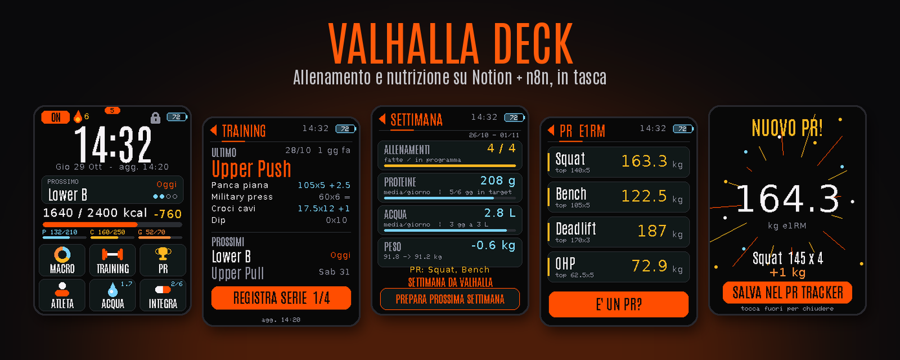
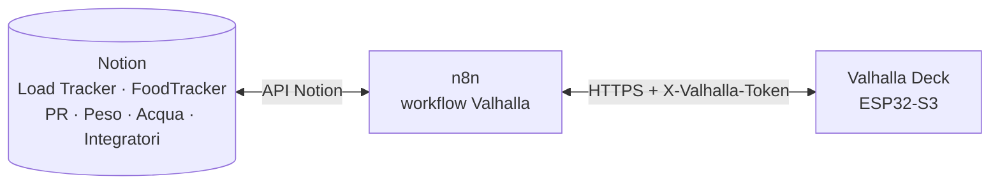
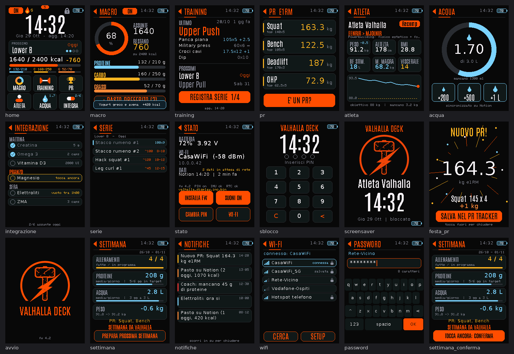

  

  
  
  

  Un display touch a batteria che porta in tasca il tuo sistema di <b>allenamento e nutrizione</b> su Notion: 
  registri serie, pasti, acqua e integratori con un tocco, vedi progressi e PR, prepari la settimana dopo con un pulsante.

  <a href="esp32/">Firmware e installazione</a> ·
  <a href="CUSTOMIZE.md">Personalizzazione</a>

---

## ✨ Cosa fa

| | |
|---|---|
| 🏋️ **Training** | piano del giorno, registrazione serie kg × reps, suggerimento di progressione, festa a ogni PR |
| 🍽️ **Nutrizione** | macro del giorno, pasti preferiti con doppio tocco, streak proteine, finestra di digiuno |
| 💧 **Acqua e integratori** | +200 / +500 / +1 L, checklist integratori per momento della giornata |
| 📅 **Settimana** | recap allenamenti, proteine, acqua, peso e PR; genera il Load Tracker della settimana dopo |
| 🔔 **Notifiche** | pannello a scorrimento dall'alto, suoni dedicati, coach proteine |
| 📶 **Sempre utilizzabile** | coda offline, riconnessione automatica, gestione Wi-Fi e aggiornamento firmware dal dispositivo |

## 🧩 Architettura

**Hardware:** Waveshare ESP32-S3-Touch-LCD-2.8 (batteria, touch, audio, IMU, RTC), collegato via Wi-Fi e HTTPS al tuo n8n.

## 📸 Tutte le schermate

  

Schermate generate con dati dimostrativi.

## 🚀 Per iniziare

1. Crea i database Notion e importa i workflow n8n → [CUSTOMIZE.md](CUSTOMIZE.md)
2. Copia `esp32/valhalla_display/secrets.example.h` in `secrets.h` e inserisci i tuoi valori
3. Compila e carica il firmware → [esp32/README.md](esp32/README.md)

## 🔐 Sicurezza

- Nessun segreto nel repository: token e password Wi-Fi si inseriscono sul dispositivo (NVS) o in file locali esclusi da Git (`secrets.h`).
- Tutti i webhook n8n richiedono l'header `X-Valhalla-Token`; HTTPS verificato con certificati radice inclusi nel firmware.

## 📄 Licenze di terze parti

- Font **Antonio**: SIL Open Font License 1.1 (`esp32/valhalla_display/LICENSE-font-Antonio.txt`)
- Driver LCD/touch derivati dagli esempi Waveshare

Made by <a href="https://github.com/TheITBear">The IT Bear</a>

