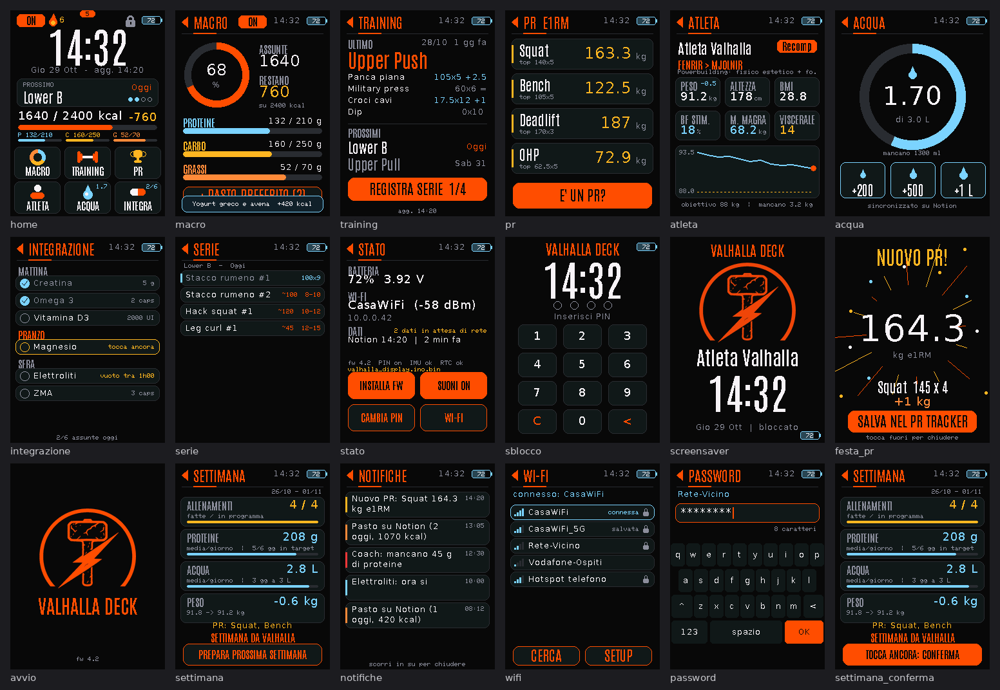

# Valhalla Deck — ESP32-S3-Touch-LCD-2.8

Display touch portatile a batteria per allenamento e nutrizione: legge e scrive su **Notion** tramite workflow **n8n** (HTTPS + header `X-Valhalla-Token`), senza PC.


*Anteprime generate con dati dimostrativi.*

## Funzioni (firmware 4.2)
| Area | Cosa fa |
|---|---|
| Home | ora, prossimo allenamento, macro del giorno, streak, icone verso le sotto-pagine |
| Macro / Pasti | anello kcal, P/C/G, pasti preferiti registrabili con doppio tocco |
| Training / Serie | piano del giorno, registrazione serie (kg × reps) con suggerimento di progressione |
| PR | e1RM Big 4, "È un PR?" con festa e salvataggio nel PR Tracker |
| Atleta, Acqua, Integrazione | scheda atleta, acqua con +200/+500/+1 L, integratori con finestra di digiuno |
| Settimana | recap settimanale + **PREPARA PROSSIMA SETTIMANA** (genera il Load Tracker della settimana dopo) |
| Notifiche | swipe giù dall'alto |
| Stato | swipe su dalla home: batteria, Wi-Fi, aggiornamento firmware da Notion, suoni, PIN |
| Wi-Fi | ricerca reti e tastiera per la password dal Deck; riconnessione automatica |
| Offline | i log senza rete vanno in coda e partono quando torna la connessione |

## 1. Segreti locali (obbligatorio, fuori da Git)
```
valhalla_display/secrets.example.h  ->  copia in  valhalla_display/secrets.h
```
In `secrets.h` metti l'URL del tuo webhook n8n (`SECRET_DEFAULT_URL`) e la password della rete di configurazione `Valhalla-Setup` (`SECRET_AP_PASS`, min 8 caratteri).
`secrets.h` è in `.gitignore`; senza il file la compilazione si ferma con un messaggio chiaro.
Il token `X-Valhalla-Token` **non** sta nel codice: si inserisce dal portale e resta nella NVS della scheda.

## 2. n8n
Workflow in `n8n/deck/` (logica dei Code node + test con `node test_*.js`):

| Workflow | Webhook |
|---|---|
| Valhalla Deck API | `GET /valhalla-deck`, `POST /valhalla-log` |
| Valhalla Deck Extra | `GET /valhalla-deck-x`, `POST /valhalla-log-x` |
| Valhalla Deck Plus | `GET /valhalla-deck-p`, `GET /valhalla-fw` |
| Valhalla Load Week | `POST /valhalla-week` → `valhalla_load_week.json` (importabile) |

Dopo l'import: sui webhook la credenziale Header Auth `X-Valhalla-Token`, sui nodi HTTP la credenziale Notion, poi Publish.
Gli ID Notion sono segnaposto `YOUR_*`: vedi [CUSTOMIZE.md](../CUSTOMIZE.md).

## 3. Compilazione e flash
Arduino IDE / arduino-cli, core esp32 3.x, LovyanGFX, ArduinoJson 7, WiFiManager 2.0.17.
Scheda **ESP32S3 Dev Module**: Flash 16MB, Partition *16M Flash (3MB APP/9.9MB FATFS)*, PSRAM OPI, USB CDC On Boot abilitato.
```
arduino-cli compile -b "esp32:esp32:esp32s3:FlashSize=16M,PSRAM=opi,PartitionScheme=app3M_fat9M_16MB,CDCOnBoot=cdc" valhalla_display
```
Aggiornamenti successivi senza cavo: carica `build/esp32.esp32.esp32s3/valhalla_display.ino.bin` nella pagina Notion "Firmware Deck", poi Stato → **INSTALLA FW** (doppio tocco).

## 4. Primo avvio
1. Dal telefono collegati alla rete **Valhalla-Setup** (password = `SECRET_AP_PASS`).
2. Apri `192.168.4.1` → scegli la rete Wi-Fi, inserisci URL n8n e `X-Valhalla-Token`.
3. Salva: il Deck si riavvia e scarica i dati.

## Sviluppo
- Font **Antonio** (SIL OFL 1.1) e logo in `assets.h`, generati da `tools/make_assets.py`.
- UI in `valhalla_display/ui.h`; driver LCD/touch Waveshare in `Display_ST7789.*`, `Touch_CST328.*`, `Touch_CST3530.*` (V1 e V2 rilevati in automatico).
- Anteprima pagine su PC: `preview/preview.cpp`.
- HTTPS verificato con root CA Let's Encrypt, Google Trust Services e SSL.com (`root_ca.h`).
